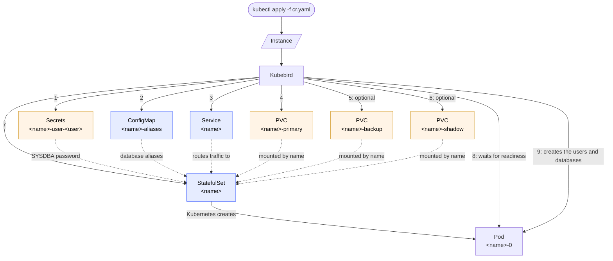

# Kubebird

## Overview
[Kubebird](https://github.com/henryx/kubebird) is a Kubernetes operator based on kubebuilder to install and manage [Firebird RDBMS](https://firebirdsql.org/) instances

## Features

- Deploys a Firebird instance as a single-replica StatefulSet from a namespaced `Instance` custom
  resource, exposed via a `ClusterIP` (or other) `Service`.
- Manages dedicated primary, backup, and shadow PVCs. The primary and shadow PVCs are always
  deleted along with the `Instance`; the backup volume — created when `spec.backup.enabled` is set
  *and* `spec.backup.destinations` has a `local` entry — always survives deletion instead, so its data can
  be restored later.
- Provisions and drops databases declared in `spec.databases` (including page size, charset,
  collation, and shadow files) as the list changes, without requiring a pod restart.
- Registers a Firebird alias per database automatically, so clients can connect by alias instead of
  in-pod filesystem path.
- Creates regular Firebird users declared in `spec.authentication`, each with its own generated (or
  supplied) password Secret, applies password changes without restarting the pod, and deletes a user
  once it's removed. A database can be owned by one of them (`spec.databases[].owner`).
- Generates a SYSDBA credentials Secret (or uses one you supply) and restarts the pod to apply the
  password whenever the Secret changes. The Secret is never removed when the `Instance` is deleted,
  so it (and its password) survive and are reused if an `Instance` with the same name is recreated.
- When a local backup volume is configured (`spec.backup.enabled` with a `local` entry in
  `spec.backup.destinations`) and `spec.backup.backupOnDelete` is `true` (the default), backs up
  every database with `gbak`, plus the security database itself (users/roles included) the same way,
  before releasing the primary/shadow storage on deletion — briefly stopping the pod first, since
  `gbak` can't back up a database while the live server has it open — then restores from those
  backups automatically if an `Instance` with the same name is recreated — including across a
  Firebird major-version bump (e.g. `3.0.14` to `4.0.3`), since `gbak` restores are forward-compatible
  with backups taken by an older version. Setting `spec.backup.backupOnDelete` to `false` skips that
  final backup while still releasing the primary/shadow storage. Without a backup volume, a
  recreated `Instance` starts fresh instead. See "Restoring an Instance" below for every case.
- Upgrades an `Instance` in place when `spec.version` changes: within a major version it just
  restarts the pod on the new image (downgrades included); to a newer major version it backs up
  every database and the security database with the old version, then restores them onto the new
  one, migrating the users per the Firebird 4.0 migration guide when coming from Firebird 3. A move
  to an older major version is refused. See "Upgrading an Instance" below.
- Warns via `status.warning`/`status.message` about orphaned backups left behind when a recreated
  `Instance` no longer declares a database that has a backup on disk.
- Independently of `backupOnDelete`, `spec.backup.retention` runs recurring scheduled backups (hourly,
  daily, weekly, monthly, and/or yearly) into the same local backup volume, deleting each
  frequency's backups once they're older than its configured retention (e.g. `3d`). Each enabled frequency gets its own native Kubernetes `CronJob`,
  which triggers a `gbak` backup of every database in `spec.databases` through the Services API,
  run by the instance's own live server, so, unlike the `backupOnDelete` backup, it never needs to
  stop the pod and the databases stay writable throughout; the result is then gzip-compressed when `spec.backup.compress` is `true`. The security database is deliberately excluded from
  these scheduled backups, since Firebird refuses to back it up remotely while the server has it open;
  it stays covered by the `backupOnDelete` backup instead.
- Surfaces `VERSION`, `STATUS`, `DATABASES`, and `MESSAGE` printer columns on `kubectl get instances`
  for at-a-glance visibility into each instance's state.

## Installation

### Prerequisites

- A Kubernetes cluster you have `cluster-admin` on (needed to install the CRD and RBAC).
- `kubectl`, configured against that cluster.
- To build from source: Go (see `go.mod` for the required version), `make`, and a container tool
  (Docker or podman) if you also want to build/push your own manager image.

### From the latest release

Tagging the repository with a semver tag (e.g. `0.2.0`) triggers the `Release` GitHub Actions
workflow, which builds and pushes the manager image to `quay.io/kubebird/operator` (tagged with
both the release version and `latest`) and publishes a GitHub Release with a consolidated
`install.yaml` (CRD + RBAC + Deployment) attached.

Install the latest release directly:

```bash
kubectl apply -f https://github.com/henryx/kubebird/releases/latest/download/install.yaml
```

This deploys the operator into the `kubebird-system` namespace. The manager requires a
`WATCH_NAMESPACE` env var (set on the Deployment) naming the namespace, or comma-separated list of
namespaces, whose `Instance` resources it should reconcile. Edit the Deployment's env after
applying, or edit `config/manager/manager.yaml` before building your own manifest, to change it.

Uninstall by deleting the same manifest (this also removes the CRD, and with it every `Instance`
resource cluster-wide):

```bash
kubectl delete -f https://github.com/henryx/kubebird/releases/latest/download/install.yaml
```

Both the release and the `dev` build below only publish once lint, unit/envtest, and e2e tests all
pass on the triggering commit. The e2e tests run against Firebird `3.0.14`, `4.0.3` and `5.0.4`.

### Development builds

Every push to `main` also publishes `quay.io/kubebird/operator:dev`, a rolling image for trying
out unreleased changes. It's not attached to a versioned tag or a GitHub Release, so build your
own manifest against it:

```bash
make build-installer IMG=quay.io/kubebird/operator:dev
kubectl apply -f dist/install.yaml
```

### From source

Clone the repository, then either build a consolidated manifest yourself:

```bash
make build-installer IMG=<your-registry>/operator:<tag>
kubectl apply -f dist/install.yaml
```

or deploy directly against the cluster in your current `~/.kube/config` context:

```bash
make deploy IMG=<your-registry>/operator:<tag>
```

`IMG` defaults to `quay.io/kubebird/operator:latest` if omitted, so if you haven't built and pushed
your own image, set it to a registry you control (`make docker-build docker-push IMG=...`) first.
`make deploy` runs `make manifests` first, so it always installs the CRD matching your checked-out
code.

To install just the CRD, without the operator itself (useful when running the manager locally via
`make run`):

```bash
make install
```

Tear down what you deployed with the matching target: `make undeploy` for `make deploy`, or
`make uninstall` for `make install` (both accept `ignore-not-found=true`).

## Architecture
Project uses the namespaced CR `Instances` that defines Firebird instance.

This is a sample of `Instances`:
```yaml
apiVersion: kubebird.github.io/v1
kind: Instance
metadata:
  name: test
spec:
  image: firebirdsql/firebird
  version: 3.0.14
  databases:
    - name: "instance.fdb"
      shadow: false
      owner: exampleUser # need to be declared in authentication section. use sysdba as default value
      pageSize: 8192 # defaults to 8192; one of 4096, 8192, 16384
      charset: UTF8 # defaults to UTF8
      collation: UTF8 # defaults to UTF8
    - name: "shadowed.fdb"
      alias: "enforced" # if not specified, uses database name as alias
      shadow: true
  service:
    type: ClusterIP
    port: 3050 # port the Service exposes the instance on; defaults to 3050
  storage:
    primary:
      class: "" # if empty, uses the default storage class
      size: 3Gi
    shadow: # can be omitted if no database below has "shadow: true"
      class: ""
      size: 3Gi
  authentication:
    sysdba:
      secretRef: "" # if empty, password is generated randomically
    exampleUser: # any other key is a regular user
      secretRef: "" # if empty, defaults to "<name>-user-exampleuser", generated
  backup: # backup section
    enabled: true # enable or disable backup
    image: firebirdsql/firebird:3.0.14 # uses a specific image (default is the same image used for instance)
    backupOnDelete: true # if enabled, execute a last backup using gbak in configured destinations when CR is deleted. default is true 
    compress: false # compress backup using gzip command. default is false
    mode: # how scheduled backups (retention) are taken; the backupOnDelete backup is always made with gbak
      type: logical # can be logical with gbak or physical with nbackup. default is logical
      incremental: false # only when backup is physical: keep a pool of a level 0 backup plus level 1 incrementals, starting a new pool (and deleting the old one) once the level 0 is older than the retention. allows only one retention frequency. default is false
    destinations:
      - local: # use a dedicated PVC
          storage:
            class: ""
            size: 3Gi
      - s3: # optional; back up to a restic repository in an S3-compatible bucket. with a local entry, copies its backups; without one, streams them
          endpoint: "" # host[:port] or http(s):// URL; empty means AWS S3
          bucket: kubebird-backups
          prefix: "" # path of the repository in the bucket; defaults to "<namespace>/<name>"
          region: "" # detected automatically when empty
          forcePathStyle: false # true for MinIO, Silo and the like
          insecureSkipTLSVerify: false # skip TLS certificate verification (e.g. self-signed); use an http:// endpoint for plain HTTP
          credentials:
            secretRef: "" # Secret with AWS_ACCESS_KEY_ID and AWS_SECRET_ACCESS_KEY; empty means the pod's ambient credentials (e.g. IRSA)
          repository:
            secretRef: "" # Secret with the repository "password" key; if empty, "<name>-restic" is generated
          image: "" # restic image; defaults to restic/restic:0.19.1
    retention: # time-based retention per frequency, as <n><unit> with unit h (hours), d (days), w (weeks), m (months), y (years). if omitted (or zero), that frequency is disabled. these backups are made with gbak, or nbackup when mode.type is physical
      hour: ""  # start every hour, e.g. "12h" deletes hourly backups older than 12 hours
      day: ""   # start at 00:00 of every day, e.g. "3d" deletes daily backups older than three days
      week: ""  # start every Sunday, e.g. "4w"
      month: "" # start first day of month, e.g. "6m"
      year: ""  # start first of January, e.g. "2y"
```

With this CR, Kubebird can:
- Deploy an instance of Firebird, in a StatefulSet mode using `image` and `version` specified, in whichever namespace the `Instance` itself is created in. The `firebird` container sets `allowPrivilegeEscalation: false` and a `RuntimeDefault` seccomp profile, satisfying the `baseline` Pod Security Standard; it does **not** run as non-root or drop capabilities, since the `firebirdsql/firebird` image's entrypoint needs root's full DAC override (e.g. to manage files owned by its own `firebird` user) whenever `FIREBIRD_ROOT_PASSWORD` is set, which Kubebird always does — so `Instance` pods can't satisfy the stricter `restricted` standard, and the namespace they run in must enforce `baseline` or looser.
- Create a service for the instance. Default service type is `ClusterIP`, exposed on `service.port` (defaults to `3050`); the pod's container port is always `3050` regardless of this setting.
- Define the PVC used for the instance's primary data (`storage.primary`), named `<instance-name>-primary`, with specified size and storage class. If storage class isn't specified, it uses the default storage class. Size must be a valid Kubernetes quantity (e.g. `3Gi`, `500Mi`); the CRD rejects anything else. This PVC isn't owned by the `Instance` (so it isn't garbage-collected alongside it), but Kubebird always deletes it itself when the `Instance` is deleted — see "Deleting an Instance" below.
- Optionally define a `<instance-name>-backup` PVC, mounted into the pod at `/var/lib/firebird/backup`, sized via `backup.destinations[].local.storage` — created only when `backup.enabled` is `true` *and* `backup.destinations` has a `local` entry (an `s3` entry adds a copy of every backup in an S3 bucket, or, without a `local` entry, takes its place; see "Copying backups to S3" below). `backup.backupOnDelete` (defaults to `true`) controls whether deleting the `Instance` runs one last backup into it first; setting it to `false` skips that final backup, but never affects whether the PVC itself is created or retained. `backup.compress` (defaults to `false`) gzips every scheduled `backup.retention` backup right after it's taken; the delete-time `gbak` backups are never compressed, and neither are backups streamed to S3, which restic compresses itself. `backup.mode` picks how the scheduled backups are taken: `gbak` (`type: logical`, the default) or `nbackup` (`type: physical`), the latter optionally `incremental`. See "Backups" and "Restoring an Instance" below for what Kubebird does with it.
- Declare a list of the databases managed by instance. Based by of the configuration, database can be instantiated in shadow mode; shadow files live on a second, separate PVC (`storage.shadow`, named `<instance-name>-shadow`), which is required if any database has `shadow: true`. Each database can also set `pageSize` (one of `4096`, `8192`, `16384`; defaults to `8192`), `charset` and `collation` (both default to `UTF8`).
- Register a Firebird alias for each database in `/opt/firebird/databases.conf` using a ConfigMap called `<instance-name>-aliases`, so clients can connect using that alias instead of the in-pod filesystem path. Uses `alias` if set, otherwise falls back to the database's own `name` (e.g. `instance.fdb`). Since this file replaces the image's own `databases.conf` rather than merging with it, Kubebird also adds a `security.db` alias for the instance's security database (`RemoteAccess = false`, so it's only reachable through the embedded/local connection Kubebird itself uses), which the image's default file would otherwise have provided.
- Keep the security database (`securityN.fdb`, `N` being the Firebird major version) on the primary PVC (`/var/lib/firebird/data`) instead of the image's own ephemeral install directory, so it survives a pod restart. A `security-database-init` init container seeds it there — on every fresh primary PVC, since Kubebird always deletes the previous one on `Instance` deletion — before the `firebird` container starts, either restoring it from a backup or seeding the image's own default (see "Restoring an Instance" below); the `security.db` alias above and a `FIREBIRD_CONF_SecurityDatabase` environment variable both point the engine at this same relocated path.
- Authentication is optional. `authentication` maps each Firebird user name to its credentials: the `sysdba` key configures SYSDBA itself, and any other key (a letter, then letters, digits or underscores, at most 31 characters) declares a regular user. Firebird user names are case-insensitive, so keys differing only in case are rejected. If a user's `secretRef` is specified, that Secret must already exist — Kubebird reads the password from its `password` key as-is (only adding the `kubebird.github.io/firebird-version` label described below) and fails reconciliation if it's missing, rather than creating it; if it isn't specified, Kubebird creates a `<instance-name>-user-<user>` secret (the user name lowercased, underscores turned into dashes, e.g. `<instance-name>-user-sysdba` or `<instance-name>-user-exampleuser`) with a random password if one doesn't already exist. For an `Instance` created by Kubebird 0.4.0 or earlier, whose generated SYSDBA secret is still named `<instance-name>-sysdba`, the new `<instance-name>-user-sysdba` secret is created with that secret's password, so SYSDBA's password doesn't change; the old secret is left in place and can be deleted afterwards. A generated secret has `username` (`SYSDBA`, or the user's key) and `password` keys, and Kubebird never deletes a user's secret, whether on its own or when the `Instance` is deleted — see "Deleting an Instance" below.
- Create each regular user in the security database once the Firebird pod is ready, through the server's Services API (`fbsvcmgr`), so it works on an `Instance` with no databases too. Changing a regular user's secret applies the new password on the running server, without restarting the pod (unlike SYSDBA's, see below); a password changed by other means is only put back the next time the secret changes. Removing a user from `authentication` deletes it from the security database; Kubebird only ever deletes users it created itself (recorded in `status.users`), never ones created by other means.
- Create each database as its `owner`: `sysdba` (the default) or a regular user declared in `authentication`, spelled exactly as its key. The database is created, and restored from its backup after a delete/recreate or an upgrade, as that user, so it's owned by it and the user has full rights on it. Firebird can't change a database's owner afterwards, so `owner` can't be set, changed or removed on a database already declared; to change it, remove the database and add it again (which drops it), or delete and recreate the `Instance` with the new owner, which restores it from its backup as the new owner.
- Label every object it creates (PVCs, Service, StatefulSet, the aliases ConfigMap, the user secrets, the scheduled backup CronJobs with their Jobs' pods, and the delete-time backup Pod) with `kubebird.github.io/instance: <name>`, so `kubectl get all,pvc,secrets,configmaps,cronjobs -l kubebird.github.io/instance=<name>` finds everything for one `Instance`. The `Service` only ever routes traffic to the `StatefulSet`'s own pod, never to a short-lived backup helper Pod/Job (scheduled or deletion-time) that happens to share that label, since its selector also requires a second `app.kubernetes.io/component: firebird` label that only the real pod carries.
- Label the Firebird server pod, the `StatefulSet`, the `Service`, the aliases ConfigMap, the PVCs, the user secrets, the scheduled backup CronJobs and the delete-time backup Pod with `kubebird.github.io/firebird-version: <version>`, the version the running server itself reports (e.g. `3.0.14`), also recorded in `status.firebirdVersion`. It's detected once per server pod, through the Services API (`fbsvcmgr -info_server_version`), so an `Instance` with no databases gets it too, and detected again whenever the pod is recreated (e.g. after changing `spec.version`). The PVCs and the user secrets (including ones you supply via `secretRef`) are created before the server runs and survive deleting the `Instance`, so Kubebird patches just this label onto them once the version is known and keeps it up to date: after recreating an `Instance` with a new `spec.version`, the retained backup PVC and secrets keep the old version's label until the new server's version is detected, then switch to it. That's the only change Kubebird ever makes to an existing PVC or secret.
- Report the most recent error, if any, in `status.error` — surfaced without needing to check the operator's own logs, via the `MESSAGE` column below. It's cleared automatically once the `Instance` reconciles successfully again.
- Warn, in `status.warning`, when a database that's provisioned or restored (i.e. `spec.databases` has a pending entry) leaves behind an orphaned backup: a `.fbk` file in the backup volume's `base/` subdirectory whose database is no longer in `spec.databases` — typically because the `Instance` was recreated with a different database list, or a database was dropped after its backup was taken. The security database's own backup (`securityN.fbk`) is never reported this way, even though it sits in that same directory. Cleared automatically once no orphaned backup remains.
- Optionally back up to an S3-compatible bucket (AWS S3, MinIO, Silo, Ceph, R2, ...) as an encrypted,
  deduplicated [restic](https://restic.net) repository: either copying every backup from the local
  backup volume, keeping the same retention as locally, or, without a local backup volume, streaming
  every backup straight into it. Either way, an `Instance` can be restored from the repository alone,
  e.g. in a new cluster. See "Copying backups to S3" below.
- Surface `kubectl get instances` columns beyond the default `NAME`/`AGE`: `VERSION` (the Firebird version deployed, from `spec.version`), `STATUS` (`Provisioning`, `Ready`, or `Deleting`), `DATABASES` (the number of databases currently provisioned, i.e. `len(status.databases)`), and `MESSAGE` (the reconcile error if the last reconcile failed; otherwise `status.warning` if one is set; otherwise, while `Provisioning`/`Ready`, why it's currently in that phase; while `Deleting`, the specific operation deletion is currently performing, e.g. "Backing up databases into the backup volume" — see "Deleting an Instance" below).

### Object creation flow

When an `Instance` is created, Kubebird creates the objects below in order (steps 1-7); every one
except the primary/backup/shadow PVCs and the user Secrets is owned by the `Instance` and removed
automatically when the `Instance` is deleted (see "Deleting an Instance" below). Kubernetes then creates the Pod from the
`StatefulSet`'s template, and once the Pod becomes ready Kubebird creates the regular users and the
requested databases inside it (steps 8-9):



The dotted arrows show how the `StatefulSet` uses the other objects (the SYSDBA password from the
secret, database aliases from the ConfigMap, traffic routing from the Service, primary/backup/shadow
data from the PVCs, referenced by name) rather than a separate creation step; the Pod, by contrast,
is created directly by Kubernetes from the `StatefulSet`'s template. The backup `PVC` only exists
when `backup.enabled` is set on the `Instance` *and* `backup.destinations` includes a `local` entry
(an `s3` entry alone streams its backups to S3 instead, with no backup `PVC`) — `backup.enabled` alone just turns on the
ability to back up, it doesn't by itself create anything (see "Backups" below). The
shadow `PVC` only exists when
`storage.shadow` is set. Before the `firebird` container in that Pod starts, a `security-database-init`
init container (mounting the primary PVC, plus the backup PVC too when it exists)
seeds the security database onto it if it isn't already there — see above.

Kubebird also reacts to updates on an existing `Instance`:
- Changing `spec.service.type`, `spec.service.port`, or `spec.version` reconciles the
  `Service`/`StatefulSet` in place.
- Adding an entry to `spec.databases` provisions just that new database (existing ones are left
  alone) and registers its alias immediately, without needing a pod restart.
- Removing an entry from `spec.databases` runs `DROP DATABASE` for just that database (Firebird
  removes its shadow file, if any, along with it), drops it from `status.databases`, and removes
  its alias from `databases.conf` — again without a pod restart.
- Adding a user to `authentication` creates it, rotating a regular user's secret changes its
  password, and removing a user deletes it, all on the running server without a pod restart.
- Rotating the SYSDBA secret's password (the auto-generated one, or a user-provided
  `authentication.sysdba.secretRef`) restarts the pod: the `StatefulSet`'s pod template carries an
  annotation hashing the secret's current password, so a rotation changes the template and the
  `StatefulSet` controller's own rolling update recreates the pod, letting the image's entrypoint
  apply the new password the same way it already does for a brand-new `Instance`. This causes a
  short disruption to every connection to the `Instance` while the pod restarts.

### Upgrading an Instance

Change `spec.version` on a live `Instance` to move it to another Firebird release. What Kubebird
does depends on how the version changes, compared with the version the `StatefulSet` currently runs:

- **Within the same major version** (e.g. `4.0.3` to `4.0.5`), in either direction: the `StatefulSet`
  simply restarts its pod on the new image, keeping the databases and the security database as they
  are. Downgrading (e.g. back to `4.0.3`) works the same way.
- **To a newer major version** (e.g. `3.0.14` to `4.0.3`, or `4.0.3` to `5.0.4`): the on-disk
  structure changes between major versions, so Kubebird moves the data the same way deleting and
  recreating the `Instance` would, without deleting it. This needs a backup destination
  (`backup.enabled` with a `local` or `s3` entry in `backup.destinations`); without one, the upgrade
  is refused and reported in `status.error`. `status.phase` is `Upgrading` meanwhile, and
  `status.upgrade` records `fromVersion`, `toVersion` and the current `stage`:
  1. `BackingUp`: the pod is stopped and every database, plus the security database, is backed up
     with `gbak` by the old version's own image (the new version's engine can't open the old on-disk
     structure) into the backup volume's `base/` directory (or streamed into the S3 repository, with
     `s3` only), exactly as on deletion, whatever `backup.backupOnDelete` says.
  2. `Releasing`: the primary and shadow PVCs are deleted.
  3. `Restoring`: the new version starts on fresh PVCs, restoring the security database and then
     every database from those backups (see "Restoring an Instance" below). Once it's all `Ready`,
     `status.upgrade` is cleared.

  When upgrading **from Firebird 3**, the security database isn't restored as is: its users are
  migrated into the new version's default security database (see "Restoring an Instance" below).
  Keep `spec.version` at the new version until the upgrade finishes; changing it meanwhile is
  refused.
- **To an older major version** (e.g. `4.0.3` to `3.0.14`): refused, since a database, or a backup,
  written by a newer major version can't be read by an older one. Kubebird reports it in
  `status.error` and leaves the running server alone; set `spec.version` back to clear it.

A tag Kubebird can't read a major version from (e.g. `latest`) is treated like a change within the
same major version.

Deleting an `Instance` in the middle of a major upgrade is safe. While still `BackingUp`, the usual
delete-time backup is taken with the old version, as the upgrade itself would. Once past it, the
delete-time backup is skipped, since the backup volume already holds the upgrade's backup of the old
version and the fresh storage holds at most part of it restored.

### Deleting an Instance

Deleting an `Instance` relies on Kubernetes garbage collection of the objects Kubebird created for
it (the aliases ConfigMap, Service and StatefulSet are all owned by the `Instance`); the
operator itself just logs the deletion, reports `status.phase: Deleting`, and updates
`status.message` with the specific operation it's currently performing (e.g. "Deleting Instance",
or one of the backup-related steps described in "Backups" below), while that garbage
collection runs. The user Secrets (SYSDBA's and the regular users') are **not** removed with it —
Kubebird deliberately never sets an owner reference on them, so an `Instance`'s credentials survive
its deletion, and are reused, passwords included, if it's recreated. The primary and
shadow PVCs aren't owner-referenced either, but Kubebird explicitly deletes both of them itself as
part of every deletion, regardless of `spec.backup` — **without a backup destination (a `local` or
`s3` entry) configured, deleting an `Instance` permanently destroys its data.** The backup PVC, when it exists, is always
left behind rather than being deleted along with the primary/shadow storage — see "Backups" below,
and "Restoring an Instance" for what a recreated `Instance` does with it. Delete it and the Secrets
yourself once you're sure you no longer need them:
```bash
kubectl delete pvc,secret -l kubebird.github.io/instance=<name>
```

### Backups

A local backup volume exists only when `backup.enabled` is `true` *and* `backup.destinations` has a `local`
entry (an `s3` entry copies the backups taken there to S3, and an `s3` entry alone streams them there instead, see "Copying backups to S3" below) — `backup.enabled` alone just turns on
the ability to back up, it doesn't create anything by itself. When configured, Kubebird provisions
the `<instance-name>-backup` PVC described above and, like the primary/shadow PVCs, never
owner-references it — but unlike them, it's also never deleted by Kubebird itself, so once created
it survives every deletion of the `Instance` for its contents to be restored from later.
`backup.image` optionally overrides the image (including tag) used to run the short-lived helper Pod
that performs the deletion-time backup below; if unset, it defaults to the same `image:version` the
`Instance` itself runs.

**On deletion**, whenever a local backup volume exists *and* `backup.backupOnDelete` is `true` (the
default), Kubebird backs up every database (with an `s3` entry and no `local` one, the same backups
are streamed into the S3 repository instead; see "S3 without a local destination" below) before releasing the primary/shadow storage (see
"Deleting an Instance" above): it first stops the pod (scaling the StatefulSet to 0 replicas), since
`gbak` can't back up a database — the security database included — while a live server still has it
open, then runs the short-lived helper Pod, mounting the same PVCs, which runs `gbak -backup -verify`
for every database in `status.databases` into a fixed `base` subdirectory of the backup volume
(`<mount>/base/<database>.fbk` — not named after the `Instance`, since the backup volume is already
a PVC dedicated to it), then the security database itself the same way, into that same directory as
`securityN.fbk`. Backing up the security database happens unconditionally, even when
`status.databases` is empty, since it always exists regardless of `spec.databases` — the only case
that skips the backup step entirely (besides `backup.backupOnDelete` being `false`) is the
StatefulSet no longer existing at all (e.g. already garbage-collected some other way), in which case
Kubebird just releases the storage directly. `status.message` tracks each step as it happens —
"Stopping the Firebird pod to back up its databases", then "Backing up databases into the backup
volume", then, always, "Releasing primary and shadow storage", then "Removing finalizer" — so
`kubectl get instances` shows real deletion progress rather than a stale pre-deletion message.
Setting `backup.backupOnDelete` to `false` skips only that final backup — the primary/shadow PVCs are
still released immediately regardless, so an already-existing backup PVC keeps whatever was in it
from an earlier backup, but nothing taken at delete time. Without any backup destination, none of this
runs at all: the primary and shadow PVCs are released immediately, and the `Instance`'s data (security
database included) is gone for good.

**On (re)creation**, an `Instance` with the same name restores its databases and its security
database from these backups; see "Restoring an Instance" below.

### Scheduled backups (`backup.retention`)

`backup.retention` runs recurring backups independently of `backupOnDelete` and the deletion flow
above, for as long as the `Instance` lives, into the same local backup volume — it requires a
backup destination just the same (`backup.enabled` *and* a `local` entry in `backup.destinations`, or
an `s3` one, see "S3 without a local destination" below) and has no effect without one. Each of its five fields (`hour`, `day`, `week`, `month`, `year`) is both the switch for that
frequency (empty, the default, or a zero duration such as `0d` disables it) and how long its backups
are kept, written as `<n><unit>` where the unit is `h` (hours), `d` (days), `w` (weeks), `m` (months)
or `y` (years). For example, `day: 3d` takes a backup every day at 00:00 UTC and deletes that
frequency's backups older than three days. Any other format is rejected by the CRD.

Kubebird creates one native Kubernetes `CronJob` per enabled frequency (`<name>-backup-<frequency>`,
e.g. `<name>-backup-hour`), on the fixed schedule its field name implies — hourly on the hour, daily at
00:00 UTC, weekly at 00:00 UTC on Sunday, monthly at 00:00 UTC on the 1st, yearly at 00:00 UTC on
January 1st — and removes it again if that frequency's retention is later unset. Kubernetes' own
CronJob controller takes it from there: Kubebird itself doesn't track or poll individual runs, so
`kubectl get cronjobs,jobs -l kubebird.github.io/instance=<name>` is the way to check a scheduled
backup's own run history or troubleshoot a failure. Each CronJob keeps its last successful Job and
its last 3 failed ones (a failed run isn't retried, so each failed Job reflects one distinct failed
attempt) for that troubleshooting.

Each run takes a `gbak` backup of every database in `status.databases`, writing
`<frequency>/<database>-<timestamp>.fbk` into the backup volume (e.g.
`hour/instance-20260924T100000Z.fbk`), where `<timestamp>` is the UTC time the run started; when
`backup.compress` is `true`, each one is then gzip-compressed to `<frequency>/<database>-<timestamp>.fbk.gz`
(gzip being the only compressor the `firebirdsql/firebird` image ships), otherwise it's left uncompressed.
Restore one with `gbak -create` (after `gunzip`, if compressed; see "Restoring a scheduled backup by
hand" below). Once every backup of the run
has succeeded, the same Job deletes every backup in that frequency's directory whose timestamp is
older than its retention (months and years follow the calendar rather than a fixed number of days),
including `.nbk` backups left by Kubebird 0.3.1 and earlier.
Files in that directory not following this naming are never touched. Since pruning only happens after
a successful run, a frequency whose runs keep failing never loses its older backups; still, pick a
retention comfortably longer than the frequency itself (e.g. `hour: 3h` rather than `hour: 1h`) so a
single missed run doesn't leave a gap. To reach the backup directory, the Job mounts the backup PVC
and, since that PVC is `ReadWriteOnce`, is scheduled onto the same node as the Firebird pod (a
required pod affinity).

**Overlapping runs.** Different frequencies regularly come due at the same moment — the hourly and
daily backups both at 00:00 UTC every day, all five on January 1st — and a Job created by hand from a
CronJob (`kubectl create job --from=cronjob/<name>-backup-<frequency> <job-name>`, e.g. to force an
out-of-band backup) can start while that CronJob's own scheduled run is still going. These runs simply
proceed side by side: `gbak` backups of the same database don't conflict with each other. Two runs of
the same frequency starting within the same second would pick the same file name, so each run first
claims its timestamp with an empty `.claim-<timestamp>` file in the frequency's directory, moving on to
the next second if another run already has it. The claim is removed when the run ends; one left
behind by a killed run is removed once it's older than the retention.

### Physical scheduled backups (`backup.mode`)

`backup.mode.type: physical` makes every scheduled run take an `nbackup` backup (`fbsvcmgr
-action_nbak`, still run by the live server through the Services API) instead of a `gbak` one,
written as `<frequency>/<database>-<timestamp>.nbk` (`.nbk.gz` when `backup.compress` is `true`) and
pruned under the same retention. A physical backup copies the database's pages, so it's faster to
take and to restore than a logical one, but it can only be restored (`nbackup -R`) by a server of the
same Firebird major version. While it runs, the database is in physical backup mode: it stays
writable (changes go to a delta file, merged back once the backup ends), but Firebird refuses a second
`nbackup` of the same database at the same time, so physical runs, across every frequency, wait for
each other on a shared `flock` (`.scheduled-backup.lock` at the root of the backup volume).

`backup.mode.incremental: true` (only allowed with `type: physical`) keeps backups in a pool instead.
A pool is a directory, `<frequency>/pool-<timestamp>`, named after the run that started it: that run
takes a full level 0 backup of each database (`<database>-level0.nbk`), every later run a level 1
backup (`<database>-level1-<timestamp>.nbk`) holding only the pages changed since that level 0. To
restore the database as of a given run, pass the level 0 and that run's level 1 to `nbackup -R`, e.g.
`nbackup -R restored.fdb pool-<ts>/instance-level0.nbk pool-<ts>/instance-level1-<ts2>.nbk` (after
`gunzip`, if compressed). Once the pool's level 0 is older than the frequency's retention, the next run
starts a new pool with a new level 0 and, once every backup of that run has succeeded, deletes the old
pool, so there's normally a single pool. A new pool is also started early whenever a database's
latest level 0 isn't the pool's own (e.g. after the `Instance` was recreated and the database
restored from its `gbak` backup), since Firebird always takes a level 1 backup relative to the
database's latest level 0. For the same reason, only one `backup.retention` frequency can be enabled
along with `incremental`; the CRD rejects more. A database added to `spec.databases` later gets its
own level 0 in the current pool on the next run.

On Firebird 4.0 and later, every level 0 backup taken this way also prunes the database's backup
history (`RDB$BACKUP_HISTORY`) down to itself (`-nbk_clean_history -nbk_keep_rows 1`), so starting a
new pool doesn't leave a row behind for every earlier run; the old pool's files don't need it to be
restored. Firebird 3.0 has no way to prune it (even SYSDBA can't delete from that system table), so
there the history keeps growing by one row per run. Kubebird picks between the two from the version the
running server reports (`status.firebirdVersion`), so the first runs right after the `Instance` starts
may not prune yet; if you set `backup.image`, use a 4.0 or later image there too.

Each scheduled backup Job is also given at most 6 hours, counted from its start, after which
Kubernetes stops it and marks it failed. This keeps a hung backup from silently stopping that
frequency's backups for good, since a CronJob never starts a new run while its previous one is still
active.

Unlike `backupOnDelete`'s backup, these scheduled runs never back up the security database:
Firebird refuses to back it up while a live server has it open, whether reached locally or remotely
through the Services API, and unlike `backupOnDelete` this flow can't stop the pod to work around
that. The security database therefore stays covered only by the `backupOnDelete` backup taken when
the `Instance` is deleted.

Unlike `backupOnDelete`'s backup, this never stops the pod, and it never locks the databases: `gbak`
reads each one inside a single snapshot transaction, so writes, and even schema changes, go on while
it runs, and the backup holds the database as it was when it started. Rather than running `gbak`
itself against the primary PVC, which a live server already has open, the CronJob's Job triggers the
backup through the [Services API](https://www.firebirdsql.org/file/documentation/html/en/firebirddocs/gbak/firebird-gbak.html)
(`fbsvcmgr -action_backup`), reaching the instance's own already-running server over the network
(through its `Service`, using the SYSDBA credentials from the Secret); the server performs the backup
and writes it directly into its own already-mounted backup volume. The Job mounts only the backup
PVC, and only to prune expired backups and, since `fbsvcmgr` can't compress its own output, to gzip
each new backup file right after it's written when `backup.compress` is `true`. Keep in mind that, as
with any long-running transaction, a backup of a large, busy database holds back garbage collection
of old record versions until it finishes.

### Copying backups to S3 (`destinations[].s3`)

An `s3` entry in `backup.destinations` backs up to a [restic](https://restic.net) repository in an
S3-compatible bucket, so the backups survive losing the backup volume, its node or the whole cluster.
Next to a `local` entry, the local volume stays where every backup is taken, and the `s3` entry
copies them; on its own, every backup is streamed into the repository instead, with no backup volume
at all (see "S3 without a local destination" below). Only one `s3` entry is allowed. restic
encrypts the repository with the password in the `password` key of the `repository.secretRef` Secret, which must already exist when set; when empty, Kubebird creates a
`<name>-restic` Secret with a random password. That Secret is mounted into every restic container
and read with `--password-file`, and, like the users' Secrets, it's never deleted with the
`Instance`. **Keep a copy of it outside the cluster**: without it, the repository can't be read.
The S3 credentials come from the `AWS_ACCESS_KEY_ID` and `AWS_SECRET_ACCESS_KEY` keys of the
`credentials.secretRef` Secret, or, when it's empty, from the pod's ambient credentials (IAM roles
for service accounts, an EC2 instance profile, ...). The repository lives under `prefix`
(`<namespace>/<name>` by default) in `bucket`; restic creates both on first use. The Firebird pods
and the backup Jobs need network access to the endpoint, so allow that egress if a NetworkPolicy
restricts it. Every snapshot is also tagged with the Firebird version its backups were taken with,
e.g. `firebird:4.0.3`: the version the running server reports (`status.firebirdVersion`), or
`spec.version` until it's detected, and, for a major upgrade's backup, the version upgraded from.

- **Scheduled backups.** Each `backup.retention` Job takes its backup first, as before, in an init
  container, then an `upload` container (running `image`, `restic/restic:0.19.1` by default) takes a
  restic snapshot of that frequency's directory, tagged with the frequency, and forgets the
  frequency's snapshots older than its retention. Since the latest snapshot always mirrors the local
  directory, a backup pruned locally stays in S3 until the last snapshot holding it is forgotten, up
  to twice the retention; in exchange, a lost or emptied backup volume doesn't take the S3 copies with
  it. A failed upload fails the Job like a failed backup.
- **Delete-time and upgrade backups.** The `gbak` backup Pod's `upload` container takes a snapshot of
  `base/`, tagged `base`, which is never forgotten. This upload is best effort: if it fails (or takes
  longer than 30 minutes, e.g. because the endpoint is unreachable and restic keeps retrying), the
  failure is only logged and the deletion or upgrade carries on, since the backup is safe on the
  backup volume, which is never deleted.
- **Restoring from S3.** The Firebird pod gets a `backup-restore` init container, which restores the
  repository's backups into an empty `base/` directory, e.g. after the backup PVC was lost; see
  "Restoring an Instance" below. Scheduled backups aren't restored automatically.
- **The security database** is only in the repository as of the last deletion or major upgrade,
  since it can only be backed up while the server is stopped; see "Restoring an Instance" below for
  what that means for its users.

Adding an `s3` entry to an existing `Instance` changes the Firebird pod's template, so its pod restarts
once.

#### S3 without a local destination

With an `s3` entry and no `local` one, Kubebird creates no backup PVC: `gbak` writes each backup to
its standard output, and restic stores it as a snapshot of a single file, under the path it would
have had on the backup volume (e.g. `/var/lib/firebird/backup/hour/<database>.fbk`). The Jobs and Pods
taking backups run the Firebird image (or `backup.image`), with restic's binary copied in by a
`restic-install` init container from the restic `image`. If `gbak` fails, restic saves no snapshot.
Since each snapshot holds a single database, every snapshot of a run also carries the same
`run:<timestamp>-<random>` tag: the run's UTC start time and 6 random hex digits, so two runs
starting in the same second (e.g. a Job created by hand next to a scheduled one) never share it
(e.g. `run:20261128T000000Z-a1b2c3`). `restic snapshots --tag run:20261128T000000Z-a1b2c3` lists, and
restores, a run's databases together.

- **Scheduled backups.** Each `backup.retention` Job streams every database's backup from the live
  server, one snapshot per database, tagged with the frequency, then forgets that frequency's
  snapshots older than its retention, every database's separately. The Jobs mount no volume, so they
  can run on any node. `backup.compress` has no effect: restic compresses the repository itself.
  `backup.mode.type: physical` isn't supported here (`nbackup` can't stream its backups), so the CRD
  requires a `local` entry for it.
- **Delete-time and upgrade backups.** The backup Pod streams every database and the security
  database into `base` snapshots. The primary volume is deleted right after, so these snapshots are
  the only copy: unlike next to a `local` entry, the upload isn't best effort, and the deletion (or
  the major upgrade) waits, retrying, until it succeeds. If the bucket is unreachable for good, set
  `backup.backupOnDelete: false` to delete the `Instance` without that last backup.
- **Restoring from S3.** Whenever the Firebird pod starts on a fresh primary volume, the backups are
  restored through a temporary `emptyDir`, deleted once every database is restored; a database added
  later restarts the pod to restore it the same way. See "Restoring an Instance" below. The node needs enough ephemeral storage for the backups meanwhile.

### Restoring an Instance

Kubebird restores automatically: there's no field asking for a restore. What decides it is what's
already on the `Instance`'s volumes and what its backup destinations hold.

#### When a restore happens

A restore only ever happens onto a **fresh primary PVC**, which is the case:

- when an `Instance` is created, including one recreated under the name of a deleted one, since
  deleting an `Instance` always deletes its primary (and shadow) PVC (see "Deleting an Instance"
  above);
- during a major version upgrade, whose `Restoring` stage starts the new version on fresh PVCs (see
  "Upgrading an Instance" above).

A plain restart of the Firebird pod (e.g. after rotating the SYSDBA password, a node drain or a
minor version change) never restores anything: the security database and the databases are still on
the primary PVC.

Restored backups are always the "base" ones, `base/<database>.fbk` and `base/security<N>.fbk`, written
by the delete-time backup and by a major upgrade (see "Backups" above). Scheduled backups are never
restored automatically (see "Restoring a scheduled backup by hand" below).

#### How it's decided

The Firebird pod goes through three steps before it's `Ready`:

1. **The `backup-restore` init container**, only with an `s3` destination, decides whether to fetch the
   backups from the repository:

   | Destinations | Doesn't fetch when | Because |
   |---|---|---|
   | `local` and `s3` | the backup PVC's `base/` directory holds anything | the local backups are at least as recent as the repository's |
   | `s3` only | the primary PVC holds `/var/lib/firebird/data/.kubebird-s3-restored` | that primary volume was already restored |

   Otherwise it lists the repository's `base` snapshots. If there are none (a new repository), it
   logs `The S3 repository holds no backup to restore` and carries on. If there are some, it writes
   the latest one of every file into `base/` (the backup PVC, or a temporary `emptyDir` with `s3`
   only), the newer one winning when two hold the same file. If the repository can't be read
   (unreachable endpoint, wrong credentials), the init container fails and the pod doesn't start: it
   never assumes there's nothing to restore.
2. **The `security-database-init` init container** leaves a security database already on the primary
   PVC alone. Otherwise, with a backup destination, it restores the most recent `base/security<M>.fbk`
   of a Firebird major version `M` no newer than `spec.version`; from a Firebird 3 backup into a newer
   version, it migrates its users into the new version's default security database instead,
   following the
   [Firebird 4.0 migration guide](https://ib-aid.com/download/docs/fb4migrationguide.html#_migrating_user_list)
   (Srp and Legacy_UserManager users alike, passwords included, all but SYSDBA). Without a backup
   destination, or such a backup, it starts from the image's default security database.
3. **Kubebird itself**, once the pod is ready, goes through every database in `spec.databases` not
   yet in `status.databases`: one whose file is already on the primary PVC is just registered (this
   only happens when a previous reconcile was interrupted), one with a `base/<database>.fbk` backup
   is restored from it with `gbak -create` (as its `owner`, recreating its shadow file for a
   `shadow: true` database), and any other one is created empty. With `s3` only, once every database
   is done, the restored copies in `base/` are deleted (they'd only take up the node's disk) and the
   marker above is written, so a later restart of the pod doesn't need the repository. A pod restarted
   before that restores again, so a database whose restore failed is restored on the next try rather
   than created empty. A database added to `spec.databases` after that, with `s3` only, makes Kubebird
   remove the marker and restart the pod, so step 1 fetches the backups again and it's restored if the
   repository has a backup of it, as with a `local` destination. A failed restore is reported in
   `status.error` and retried.

Users and passwords follow the security database: users created directly in it come back with it,
and every regular user in `authentication` is then applied again from its Secret, which survives the
deletion, so they can always log in, even when the security database started fresh. SYSDBA's password
always comes from its Secret, never from the restored security database. A restored database is owned
by its `owner`, whoever owned it when it was backed up.

#### Scenarios

| Scenario | What happens |
|---|---|
| New `Instance`, no backup destination | Starts fresh: empty databases, the image's default security database. |
| New `Instance` whose destination holds no backup yet | Starts fresh, the same way. |
| Recreated under the same name, with a `local` destination | Restores from the backup PVC, which survived the deletion: the delete-time backup, or, with `backupOnDelete: false`, whatever an earlier backup left in `base/` (nothing, the first time). |
| Recreated under the same name, without a backup destination | Starts fresh: the data was deleted with the primary PVC. Users from `authentication` are created again, owning empty databases. |
| Recreated with a different `spec.databases` | A database in both lists is restored, a new one is created empty, and the backup of one no longer listed isn't restored but reported in `status.warning` (and the `MESSAGE` column). |
| Recreated with a newer `spec.version` | Restored as usual: `gbak` restores backups of older versions, and the security database comes from the older version's backup (migrated from Firebird 3). This doubles as a major upgrade, though changing `spec.version` in place does the same without deleting the `Instance`. |
| Recreated with an older major version | Not supported: a backup written by a newer major version can't be read by an older one. |
| In-place major upgrade | The `Restoring` stage restores from the backups the `BackingUp` stage just took, the same way (see "Upgrading an Instance" above). |
| Database added to a running `Instance` | Restored if there's a `base/<database>.fbk` backup of it, created empty otherwise. With `s3` only, `base/` is gone once the first restore is done, so Kubebird restarts the pod to fetch the repository's backups again first (even when it has none of that database); with a `local` destination, the pod keeps running. |
| Backup PVC lost, with `local` and `s3` | The recreated `Instance` starts with an empty `base/`, so `backup-restore` fills it from the repository first. |
| `s3` only | Every new or recreated `Instance` (and every major upgrade) checks the repository, since its primary PVC is always fresh. |
| Another namespace or cluster | Only from S3: create the `Instance` there with the same repository password (`repository.secretRef`) and `prefix` pointing at the original repository. |
| Pod restart | Nothing is restored (see above). |

Since it's the backups that exist, not whether an `Instance` is meant to be new, that decide:

- **To start fresh under a name already used**, delete the retained backup PVC (`<name>-backup`) and,
  with `s3`, point `prefix` (or `bucket`) somewhere else or empty the repository first. The S3
  repository defaults to `<namespace>/<name>` in `bucket`, so it's shared by every `Instance` ever
  created under that name and namespace.
- **Keep the restic password.** The `<name>-restic` Secret survives deleting the `Instance`, so a
  recreated one reads the same repository. If it's deleted, a new `Instance` generates a new password
  and can't read the existing repository: keep the Secret, and a copy of it outside the cluster.
- **The security database** can only be backed up while the server is stopped, i.e. at deletion or
  during a major upgrade, never by scheduled backups. Users created directly in it since the last of
  those are lost by a restore; users declared in `authentication` are put back from their Secrets
  anyway.

#### Restoring a scheduled backup by hand

Scheduled backups are kept for you to restore by hand, into a new database or over an existing one:

- a `gbak` backup on the backup volume, `<frequency>/<database>-<timestamp>.fbk[.gz]`, with
  `gbak -create` (after `gunzip`, if compressed);
- a physical one, `<frequency>/<database>-<timestamp>.nbk[.gz]`, with `nbackup -R`, or, for
  `incremental` pools, the pool's level 0 plus a run's level 1 (see "Physical scheduled backups"
  above);
- from S3, with `restic restore` or `restic dump` of a snapshot tagged with the frequency, using the
  repository password from the `<name>-restic` Secret. With a `local` destination too, a snapshot
  holds the frequency's whole directory; with `s3` only, every snapshot holds a single database's
  backup, `/var/lib/firebird/backup/<frequency>/<database>.fbk`, e.g.
  `restic dump latest --tag hour --path /var/lib/firebird/backup/hour/instance.fbk /var/lib/firebird/backup/hour/instance.fbk > instance.fbk`
  (`--path` picks that database's own latest snapshot), and the `run:<timestamp>-<random>` tag finds every
  database of the same run. The `firebird:<version>` tag tells which Firebird version a backup needs
  to be restored with (that version or a newer one).

## License

Kubebird is licensed under the [Apache License 2.0](LICENSE).